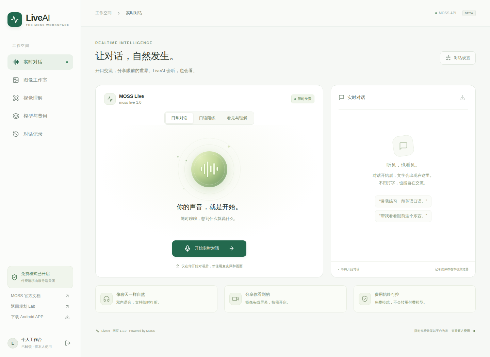

# LiveAI

A self-hosted MOSS workspace, built for **moss-live-1.0** realtime audio/video conversations. React with an Android native direct client, and Web Audio + an authenticated Node WebSocket gateway for desktop browsers. No GPU required; inference runs on the MOSS API.

Live demo: https://guihualab.cn/liveai/ (requires the owner's existing Guihua Lab shared password).

Android 2.0：手机音视频直连 MOSS，支持前台服务维持锁屏语音、耳机通话路由、本机加密记住密码，以及简洁的通话首页。APP 内通过底部「对话／图像／视觉／模型／记录」切换全部工具；日常对话、口语陪练、看见与理解和自定义提示词在设置中切换。工具页面保留输入、上传和图像任务，切换页面不结束原生通话。首次配置和 OTA 更新使用规划 Lab，通话媒体不经过它。摄像头离开前台即暂停，语音继续；系统强制停止或断网仍会中断，不能绕过手机系统限制。

网页体验：使用规划 Lab 共享密码解锁，点击「开始实时对话」，授权麦克风后直接说话。摄像头、屏幕共享在通话中按需开启；点击「结束对话」释放设备。首页接入的是你要体验的 **MOSS Live** 模型。免费与付费独立展示，当前付费调用全部关闭。

## Features

- Realtime microphone conversations, streamed 48 kHz voice playback and live transcripts.
- Camera and screen sharing, enabled only after explicit user interaction. Audio: 16 kHz mono PCM S16LE upstream, 48 kHz downstream; tagged-v1 JPEG frames. Playback acknowledgements follow actual playback, including interruption handling.
- Three personas, editable instructions, mic mute, end-call device cleanup, bounded session length, connection backpressure and authentication checks.
- MOSS Image SFT/Base image generation; successful images can be opened and saved. Upstream URLs expire.
- Separate free and paid catalogs. Paid operations are disabled server-side and have no automatic fallback. Official free offers are **limited time**, not a permanent guarantee.
- Transcripts stored only in the current browser (last 60 conversations), with export and deletion. Microphone and camera media are sent to MOSS only during active sessions; this server does not archive raw media or conversation text.
- Persistent server usage counts for web relay calls, including maintenance tests; native direct calls bypass these counters. APP connection information shows session traffic locally. Neither figure is account balance or provider billing records.
- Android microphone foreground service, partial wake lock, notification mute/end controls, actual input-device display, communication-mode Bluetooth/USB/wired routing. Native camera sends compressed ≤480 px JPEG snapshots at up to 1 fps, capped at 32 KB; congestion drops images before audio.
- Initial authenticated native configuration uses RSA-OAEP SHA-256; runtime secrets, remembered password and new native transcripts are encrypted with Android Keystore AES-GCM. No secrets are embedded in public APK/OTA assets. Legacy local browser history remains visible. No cloud conversation sync.

## Current upstream state (2026-11-03)

MOSS Live completed a browser-to-upstream voice conversation with real audio playback acknowledgements and `response.ended=completed`; camera frame transmission and device cleanup were also checked. The test used a synthetic microphone/camera, not a physical phone. MOSS Image SFT generated a real image. Some free model IDs are absent from `GET /v1/models`, so the catalog uses the official documentation with explicit verification labels. MOSS VL currently returns `model or version not found`; its upload/retry entry is marked unavailable. VL Realtime has a separate protocol and is cataloged only; realtime vision in this application uses MOSS Live. Paid speech synthesis, voice design and transcription are listed with official pricing but intentionally disabled.

Official documentation: https://platform.moss.cn/en/docs/models/ and https://platform.moss.cn/en/docs/reference/moss-live/

## Run locally

Requires Node 22.12+ and npm. Install with `npm ci --include=dev`. Configure `MOSS_KEY_FILE` to a permission-restricted text file containing your own MOSS key. Never commit it. The default file is `/etc/liveai/moss.key`.

The default authentication integration validates the existing Guihua Lab service (`AUTH_BASE=http://127.0.0.1:4190`, `/api/share/login`, `/logout`, `/session`). This repository does not contain a default password, credentials or an authentication bypass. For a standalone installation, implement the same authentication contract in your own service or replace that adapter; do not expose the inference endpoints without authentication.

Run `npm run build && npm start`. The server binds to `127.0.0.1:4260`. Publish it via HTTPS with `/liveai/*` stripped when proxying. Set `PUBLIC_ORIGIN` to your exact HTTPS origin and ensure the WebSocket proxy preserves Origin and cookies. For Vite development run `npm run dev` alongside the backend, with the matching development origin configured.

## Server deployment

The deployment template is `deploy/liveai.service`. Provision `/etc/liveai/moss.key` readable only by the service account, and `/var/lib/liveai` writable by it. Copy the systemd unit to `/etc/systemd/system/liveai.service`, reload systemd and enable it. Existing Guihua Lab authentication must remain running.

One-command updates: `npm run deploy` (requires permission to write `/var/www/liveai` and restart this unit). It runs tests, builds, creates a new immutable source/static release, retains the previous five releases' hashed assets for in-flight page loads, atomically switches `current`, checks health and rolls back on failure. Releases reuse the installed dependency directory; run `npm ci --include=dev` when dependencies change before deployment.

Use a Caddy `handle_path /liveai/*` reverse proxy to loopback port 4260. Forward `X-Real-IP {client_ip}` with trusted proxy configuration. Keep all other project routes and access controls intact. The login cookie is HttpOnly, Secure, SameSite=Strict and scoped to `/liveai/`.

Paid capability handlers are not implemented in this release. Changing `ENABLE_PAID_MODELS` does not enable paid endpoints; those handlers continue to return `PAID_DISABLED`. Explicit implementation and authorization are required before paid use.

## Checks

Mobile functionality regression (after `npm run build`): `node scripts/check-mobile-workspace.mjs`, with Playwright installed in the environment or `PLAYWRIGHT_MODULE=/absolute/path/to/playwright/index.mjs`. This uses browser-only API/native-bridge fixtures, verifies all five tabs, in-flight image/result preservation, uploaded-image/draft preservation, remembered tool login, paid locking, presets, history export, ongoing native call state, and desktop tools. It makes no actual provider or hardware calls. Screenshots and sanitized results are written to ignored `artifacts/`.

`npm test` covers playback acknowledgement ordering, interruption accounting, paid/unknown model rejection, API access, cookie scoping, origin restrictions and unauthenticated WebSocket rejection. `npm run build` builds the responsive frontend. Real API smoke tests and browser checks are recorded in `docs/verification.md`.

An independent signed Android shell is available: [direct IP APK download](http://42.192.115.30:8182/downloads/liveai/liveai-latest.apk), [HTTPS APK download](https://guihualab.cn/liveai/downloads/liveai-latest.apk). It follows the existing Dayweave native WebView + full-bundle OTA design and keeps the `https://guihualab.cn` origin. See [Android installation, update and build instructions](docs/android.md).

APK 2.0.0 / code 3 preserves the original package/signature and can cover-install without uninstalling. Allow microphone, Nearby devices/Bluetooth and notification permissions; use Settings → lock-screen calling to permit background battery use. The APK supports native microphone/camera capture and text export. Web tools retain image generation and upload. Android WebView does not provide this application's browser display-capture API; use the desktop website for screen sharing. Camera/microphone require user permission. Real nubia M153 hardware verification has not been performed.

## License

MIT. MOSS API use, model availability and pricing remain subject to the provider's terms. This project is an independent client and is not an official MOSS product.
